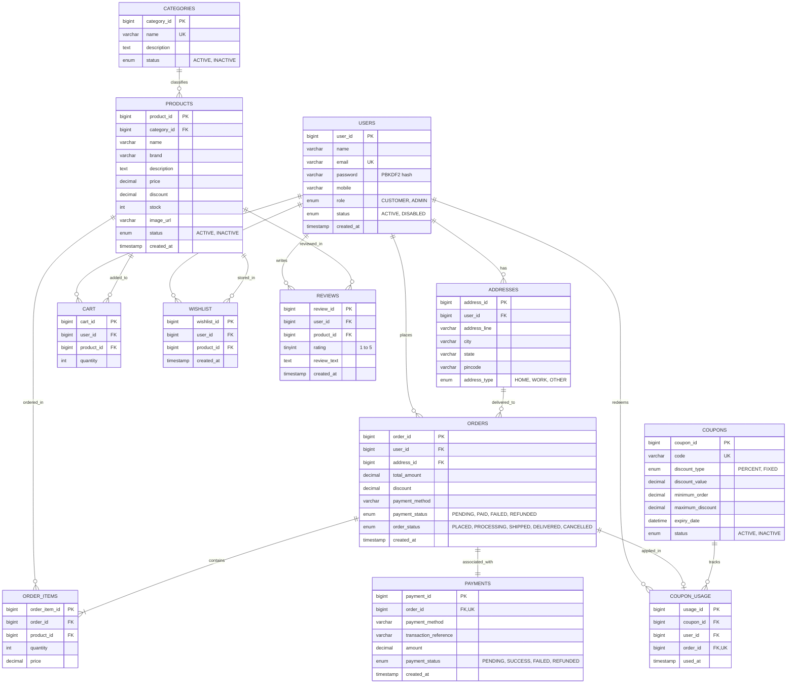

# ShopSphere Database Design & Entity-Relationship (ER) Diagram

This document models the relational schema for ShopSphere based on Section 8 of the *RTU Advanced Java Project Development Guide*.

---

## Entity-Relationship Diagram

---

## Schema Summary and Constraints

| Table | Primary Key | Foreign Keys | Key Integrity Constraints |
|---|---|---|---|
| `users` | `user_id` | - | `email UNIQUE`, password stored as PBKDF2 hash |
| `addresses` | `address_id` | `user_id` &rarr; `users.user_id` (CASCADE) | Delivery destination tied to user |
| `categories` | `category_id` | - | `name UNIQUE` |
| `products` | `product_id` | `category_id` &rarr; `categories.category_id` (RESTRICT) | `CHECK (price >= 0)`, `CHECK (discount BETWEEN 0 AND 100)`, `CHECK (stock >= 0)` |
| `cart` | `cart_id` | `user_id`, `product_id` (CASCADE) | `UNIQUE (user_id, product_id)`, `CHECK (quantity > 0)` |
| `wishlist` | `wishlist_id` | `user_id`, `product_id` (CASCADE) | `UNIQUE (user_id, product_id)` |
| `orders` | `order_id` | `user_id`, `address_id` (RESTRICT) | `CHECK (total_amount >= 0)` |
| `order_items` | `order_item_id` | `order_id` (CASCADE), `product_id` (SET NULL) | `CHECK (quantity > 0)` |
| `payments` | `payment_id` | `order_id` (CASCADE) | `order_id UNIQUE`, `CHECK (amount >= 0)` |
| `reviews` | `review_id` | `user_id`, `product_id` (CASCADE) | `UNIQUE (user_id, product_id)`, `CHECK (rating BETWEEN 1 AND 5)` |
| `coupons` | `coupon_id` | - | `code UNIQUE`, `CHECK (discount_value > 0)`, `CHECK (minimum_order >= 0)` |
| `coupon_usage` | `usage_id` | `coupon_id` (RESTRICT), `user_id` (RESTRICT), `order_id` (CASCADE) | `order_id UNIQUE` (prevents double logging per order) |
