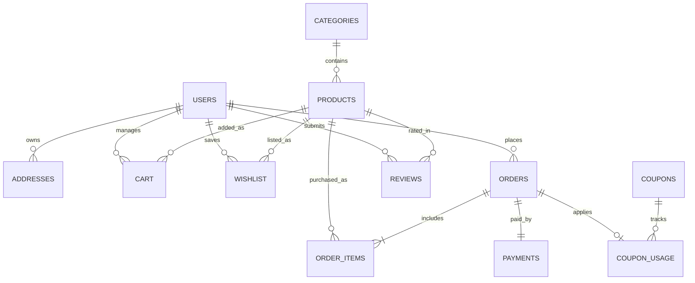

# SHOPSPHERE: ADVANCED JAVA E-COMMERCE MANAGEMENT SYSTEM
## Final Academic Project Report
**Course / Curriculum**: RTU Advanced Java / Java Enterprise Application Development  
**Target Environment**: Jakarta EE 10 / Apache Tomcat 11.0.26 / OpenJDK 17+ / MySQL Server 8.4  
**Project Architect**: ShopSphere Development Team  
**Evaluation Standard**: RTU B.Tech Computer Science / Information Technology Project Guidelines  

---

## TABLE OF CONTENTS
1. [Introduction](#1-introduction)
2. [Problem Statement](#2-problem-statement)
3. [Project Objectives](#3-project-objectives)
4. [Requirements Specification](#4-requirements-specification)
5. [Technology Stack](#5-technology-stack)
6. [System Architecture](#6-system-architecture)
7. [Database Design](#7-database-design)
8. [Module Design](#8-module-design)
9. [Implementation Details](#9-implementation-details)
10. [Testing and Quality Assurance](#10-testing-and-quality-assurance)
11. [User Interface and System Guide](#11-user-interface-and-system-guide)
12. [RTU Syllabus Mapping Matrix](#12-rtu-syllabus-mapping-matrix)
13. [Limitations and Future Scope](#13-limitations-and-future-scope)
14. [Conclusion and References](#14-conclusion-and-references)

---

## 1. INTRODUCTION
**ShopSphere** is an enterprise-grade, distributed e-commerce management system designed and developed as a comprehensive capstone practical project for Advanced Java. Unlike trivial web applications, ShopSphere unifies the complete spectrum of Java enterprise, desktop, networking, and distributed computing standards inside a single coherent architecture.

The customer-facing application provides a modern responsive online store for browsing catalogs, filtering products, managing shopping carts, saving delivery addresses, applying promotional coupons, and executing secure, multi-table transactional order checkouts. In parallel, the desktop administration module leverages **Java Swing** with pluggable Look-and-Feel for back-office catalog and inventory control. Distributed services are powered by **Java RMI** and **TCP Socket (`java.net`)** servers, demonstrating inter-process communication, remote object registries, and binary object serialization.

---

## 2. PROBLEM STATEMENT
Traditional academic web applications frequently suffer from three primary shortcomings:
1. **Monolithic or Disjointed Architecture**: Students typically build either an isolated desktop GUI or a toy web app that ignores enterprise patterns like N-tier layering, transactional ACID integrity, and thread-safe session tracking.
2. **Artificial Syllabus Segregation**: Topics such as Java Sockets, Remote Method Invocation (RMI), Object Serialization, and JNDI are often presented as disconnected command-line exercises with no realistic relationship to business software.
3. **Fragile Security and Resource Management**: Many projects concatenate raw SQL strings, store unhashed passwords, trust client-side calculation of order totals, and leak database connections.

ShopSphere resolves these challenges by embedding every syllabus topic into a realistic enterprise e-commerce system that shares persistent data across web servlets, desktop GUIs, and network sockets without compromising security or architectural purity.

---

## 3. PROJECT OBJECTIVES
The core objectives of the ShopSphere project include:
- **Architectural Separation**: Implement a strict N-tier Model-View-Controller (MVC) structure separating presentation (JSP, EL, JSTL, Tag Files), controllers (Jakarta Servlets), business logic (Services), and data access (DAOs with JDBC).
- **Relational Data Integrity**: Design and normalize a 12-table MySQL relational database with check constraints, foreign key cascades, and atomic multi-table transaction commits/rollbacks.
- **Enterprise Web Standards**: Deploy on **Apache Tomcat 11** utilizing the `jakarta.servlet.*` API (Servlet 6.1), `HttpSession`, `Cookie` state handling, `@WebListener` lifecycle hooks, and `@WebFilter` security boundaries.
- **Desktop Management**: Build an administrative desktop client using **Java Swing** components (`JFrame`, `JTable`, `JTabbedPane`, `JOptionPane`) connecting directly to the persistent store.
- **Distributed Computing & Networking**:
  - Implement an inventory server using `ServerSocket` and `Socket` communicating via both textual commands and binary `ObjectOutputStream`/`ObjectInputStream` serialization.
  - Implement a distributed remote service using **Java RMI** (`Remote`, `RemoteException`, `LocateRegistry`, `Naming.rebind/lookup`).
- **Internationalization & Protocol Handling**: Support multilingual interfaces (`ResourceBundle`, English and Hindi locales) and educational URLConnection handlers.

---

## 4. REQUIREMENTS SPECIFICATION

### 4.1 Functional Requirements
- **Customer Authentication**: Account registration with duplicate email validation, PBKDF2 password hashing, secure session login, session fixation rotation (`request.changeSessionId()`), and clean session invalidation on logout.
- **Product Catalog & Browsing**: Active product grid rendering, keyword search across titles, category filtering, price/alphabetical sorting, and detailed product view with star ratings and reviews.
- **Cart & Wishlist Operations**: Add to cart, quantity increments/decrements with real-time stock ceiling validation, item removal, and persistent wishlist tracking.
- **Order Checkout & Payment**: Address selection, coupon code validation (minimum purchase, percentage vs flat discount, expiry verification), server-side total re-calculation, mock payment authorization, and atomic stock decrements.
- **Order Tracking & History**: User-specific purchase history sorted chronologically with dynamic order status badges (PLACED, PROCESSING, SHIPPED, DELIVERED, CANCELLED).
- **Back-Office Administration**: Web and Swing administrative dashboards displaying key performance metrics (product counts, active customer counts, total order volume, low-stock alerts, net revenue excluding cancelled orders), product CRUD, category CRUD, and order status lifecycle updates.

### 4.2 Non-Functional Requirements
- **Security**: Universal `PreparedStatement` parameterization to prevent SQL Injection; PBKDF2 password derivation; `HttpOnly` cookie flags; role-based URL access control filters.
- **Maintainability & Modularity**: Multi-module Maven build structure (`web`, `swing-admin`, `network`, `rmi`).
- **Portability**: Standard Java 17+ bytecode and platform-independent JDBC connectivity.

---

## 5. TECHNOLOGY STACK

| Component Layer | Technology / Specification | Version | Purpose |
|---|---|---|---|
| **Programming Language** | Java (JDK) | OpenJDK 17 / 24 | Core application logic, models, services |
| **Web Container** | Apache Tomcat | 11.0.26 | Jakarta EE 10 servlet container |
| **Web Controller** | Jakarta Servlet API | 6.1.0 | Request dispatching, session handling, filtering |
| **View Layer** | Jakarta Server Pages (JSP) | 3.1 | Dynamic presentation with EL and JSTL |
| **Component Tags** | JSTL (Core, Functions, XML, SQL) | 3.0.1 | Logic-free presentation and syllabus demos |
| **Database** | MySQL Server | 8.4 LTS | Persistent relational storage |
| **Database Connectivity**| JDBC / MySQL Connector/J | 9.3.0 | Type 4 pure Java database driver |
| **Desktop GUI** | Java Swing & AWT | Standard JDK | Desktop administrator management tool |
| **Network Communication**| java.net Sockets | Standard JDK | TCP client-server inventory query service |
| **Distributed Systems** | Java RMI | Standard JDK | Remote object invocation and RMI Registry |
| **Build & Packaging** | Apache Maven | 3.9.16 | Multi-module build lifecycle and dependency management |
| **Styling & UI** | CSS3 + Bootstrap | 5.3.8 CDN | Modern, mobile-responsive e-commerce theme |

---

## 6. SYSTEM ARCHITECTURE

ShopSphere is organized into an enterprise **N-Tier Architecture**:

```mermaid
flowchart TD
    subgraph Client Tier
        Browser["Customer Browser (Chrome / Firefox / Edge)"]
        SwingApp["Desktop Admin Client (Java Swing GUI)"]
        SockClient["Inventory Socket Client (CLI)"]
        RmiClient["Inventory RMI Client (CLI)"]
    end

    subgraph Web Tier ["Web Container (Apache Tomcat 11)"]
        Filter["Security Filters (AuthenticationFilter / AdminFilter)"]
        Servlet["Jakarta Servlet Controllers (*Servlet.java)"]
        JSP["Presentation Layer (JSP / EL / Tag Files / Fragments)"]
    end

    subgraph Service Tier ["Business Logic Layer"]
        AuthSvc["AuthService"]
        ProdSvc["ProductService"]
        OrderSvc["OrderService"]
        CheckSvc["CheckoutService (Transactional)"]
    end

    subgraph Distributed Tier ["Distributed Network Services"]
        SockServer["InventoryServer (ServerSocket :5050)"]
        RmiServer["InventoryServiceImpl (RMI Registry :1099)"]
    end

    subgraph Data Access Tier ["DAO Layer"]
        DAOs["UserDAO / ProductDAO / OrderDAO / CartDAO / AdminDataDAO"]
    end

    subgraph Persistence Tier ["Database"]
        MySQL[("MySQL 8.4 Relational Database (12 Tables)")]
    end

    Browser <-->|HTTP / HTTPS| Filter
    Filter <--> Servlet
    Servlet <--> JSP
    Servlet <--> Service Tier
    Service Tier <--> DAOs
    SwingApp <--> DAOs
    SockClient <-->|TCP Socket| SockServer
    RmiClient <-->|RMI Protocol| RmiServer
    SockServer <--> DAOs
    RmiServer <--> DAOs
    DAOs <-->|JDBC (PreparedStatement)| MySQL
```

### Request Lifecycle
1. **Client Request**: Customer submits an action (e.g., POST `/checkout`).
2. **Interception**: `AuthenticationFilter` verifies session validity.
3. **Controller Processing**: `CheckoutServlet` extracts request parameters and validates identity.
4. **Service Coordination**: `CheckoutService` initiates a JDBC transaction (`autoCommit=false`), checks stock, calculates totals, applies coupons, updates orders, decrements inventory, and issues a commit.
5. **View Rendering**: Browser receives a redirect to `order-success.jsp` rendering the generated order receipt.

---

## 7. DATABASE DESIGN

The ShopSphere schema encompasses **12 relational tables** engineered in MySQL 8.4 InnoDB engine with UTF-8 character encoding (`utf8mb4`).



### Table Definitions and Schema Constraints
1. **`users`**: Stores customer and administrator accounts with unique email constraints, roles (`CUSTOMER`, `ADMIN`), and active status flags.
2. **`addresses`**: Stores multiple shipping destinations per customer (`HOME`, `WORK`, `OTHER`) with foreign key cascade on user deletion.
3. **`categories`**: Product classifications with unique category names.
4. **`products`**: Catalog inventory with foreign key links to categories, price check (`price >= 0`), discount percentage check (`0 <= discount <= 100`), and stock checks (`stock >= 0`).
5. **`cart`**: Active customer shopping carts with unique composite key `(user_id, product_id)` and quantity constraints (`quantity > 0`).
6. **`wishlist`**: Saved-for-later items with unique constraint `(user_id, product_id)`.
7. **`orders`**: Master purchase records storing user ID, shipping address ID, net amount, applied discount, payment status, and order tracking lifecycle status.
8. **`order_items`**: Line items detailing product ID, purchased quantity, and recorded historical line price.
9. **`payments`**: Payment audit records with 1:1 foreign key binding to `orders`.
10. **`reviews`**: Customer ratings (constrained to integers 1–5) and review text with unique `(user_id, product_id)` constraint.
11. **`coupons`**: Promotional codes with discount type (`PERCENT`, `FIXED`), discount value, minimum order value, maximum discount cap, and expiration timestamp.
12. **`coupon_usage`**: Audit log recording single-use coupon redemptions per user and order.

---

## 8. MODULE DESIGN

### 8.1 Web Module (`web`)
- **Controllers (`com.shopsphere.controller`)**: 23 Jakarta Servlets handling routing for auth, catalog, cart, checkout, orders, admin panels, and syllabus demonstrations.
- **Services (`com.shopsphere.service`)**:
  - `AuthService`: Registration validation, duplicate checks, PBKDF2 hash verification.
  - `ProductService`: Catalog queries, stock verification, and product updates.
  - `OrderService`: Order history lookups and status lifecycle transitions.
  - `CheckoutService`: Transactional ACID order processing across 5 database tables.
- **DAOs (`com.shopsphere.dao`)**: 13 Data Access Objects handling prepared statement execution and ResultSet object mapping.
- **Filters & Listeners**:
  - `AuthenticationFilter`: Guards customer-only routes (`/cart/*`, `/checkout/*`, `/orders/*`, `/profile/*`, `/wishlist/*`).
  - `AdminFilter`: Guards administrative routes (`/admin/*`) ensuring `ADMIN` role.
  - `AppListener`: ServletContextListener configuring application parameters and datasource.
  - `SessionListener`: HttpSessionListener tracking live active sessions via thread-safe `AtomicInteger`.

### 8.2 Desktop Admin Module (`swing-admin`)
- Built with standard Java Swing components.
- `ShopSphereAdmin`: Main application entry point setting the system Look-and-Feel (`UIManager.getSystemLookAndFeelClassName()`).
- `LoginFrame`: Dedicated authentication window with password masking.
- `AdminDashboard`: Tabbed administrative control panel utilizing `JTabbedPane`:
  - **Products Tab (`ProductPanel`)**: Table displaying catalog inventory with low-stock filtering, Add dialog, Edit dialog, and Delete actions.
  - **Categories Tab (`CategoryPanel`)**: Add, Edit, Delete, and List categories.
  - **Customers Tab (`CustomerPanel`)**: Customer directory viewing join dates and contact details.
  - **Orders Tab (`OrderPanel`)**: Real-time order monitoring with interactive order status modification dialog.
  - **Inventory Tab (`InventoryPanel`)**: Automated filter isolating low-stock items (`stock <= 5`) with direct stock adjustment controls.

### 8.3 Networking Module (`network`)
- `InventoryServer`: TCP server listening on port 5050 with multithreaded client handling (`ServerSocket`).
- `InventoryClient`: Interactive socket client executing:
  - `GET_PRODUCT <id>`: Returns a serialized `Product` object using `ObjectInputStream`.
  - `GET_ORDER <id>`: Returns a serialized `Order` object using `ObjectInputStream`.
  - `GET_STOCK <id>`: Returns raw stock count text.
  - `SEARCH_PRODUCT <query>`: Returns matching catalog products.
- `UrlConnectionDemo`: Protocol handler utility demonstrating `java.net.URL` and `URLConnection` stream reading.

### 8.4 Distributed Module (`rmi`)
- `InventoryService`: Remote interface extending `java.rmi.Remote` declaring remote methods throwing `RemoteException`.
- `InventoryServiceImpl`: Remote implementation querying MySQL products.
- `InventoryServer`: Creates or attaches to RMI Registry on port 1099 and binds `InventoryService` via `Naming.rebind()`.
- `InventoryClient`: Resolves the remote stub using `Naming.lookup()` and invokes remote methods across JVM boundaries.

---

## 9. IMPLEMENTATION DETAILS

### 9.1 Secure Password Hashing (PBKDF2)
Passwords in ShopSphere are never stored in plaintext. Passwords are salted with 16 cryptographically secure random bytes and derived over **210,000 iterations** using `PBKDF2WithHmacSHA256`:
```java
// PBKDF2 Implementation in PasswordUtil.java
PBEKeySpec spec = new PBEKeySpec(password, salt, 210000, 256);
byte[] hash = SecretKeyFactory.getInstance("PBKDF2WithHmacSHA256").generateSecret(spec).getEncoded();
```
Verification utilizes constant-time comparison via `MessageDigest.isEqual()` to prevent side-channel timing attacks. In addition, memory safety is enforced by storing passwords in `char[]` arrays and explicitly overwriting memory with `Arrays.fill(password, '\0')`.

### 9.2 Transactional Checkout Coordination
To guarantee that stock counts never desynchronize from placed orders, `CheckoutService.java` manages explicit database transactions:
```java
connection.setAutoCommit(false);
try {
    // 1. Verify address ownership
    // 2. Validate active cart items & sufficient stock
    // 3. Compute server-side subtotal and apply coupon discounts
    // 4. Insert master Order record
    // 5. Decrement stock atomically (UPDATE products SET stock = stock - ? WHERE product_id = ? AND stock >= ?)
    // 6. Insert OrderItems
    // 7. Record coupon usage and mock payment
    // 8. Clear customer cart
    connection.commit();
} catch (Exception ex) {
    connection.rollback();
    throw ex;
} finally {
    connection.setAutoCommit(true);
}
```

---

## 10. TESTING AND QUALITY ASSURANCE

### 10.1 Live Runtime Verification Results

| Test Scenario | Verification Mechanism | Expected Result | Observed Result | Verdict |
|---|---|---|---|---|
| **Customer Registration** | Live HTTP POST `/register` | User created; 302 redirect to login | Redirected with `?registered=1` | **PASSED** |
| **Duplicate Registration** | Live HTTP POST `/register` | Duplicate email rejected with alert | "An account with this email already exists" | **PASSED** |
| **Valid Login** | Live HTTP POST `/login` | Session created; session ID rotated | 302 to `/products`; `JSESSIONID` rotated | **PASSED** |
| **Invalid Login** | Live HTTP POST `/login` | Authentication failure error shown | HTTP 200 with "Email or password is incorrect" | **PASSED** |
| **Unauthenticated Route Guard** | Live HTTP GET `/cart` | Blocked by filter; redirect to login | HTTP 302 redirect to `/shopsphere/login` | **PASSED** |
| **Admin Route Protection** | Customer session GET `/admin/dashboard` | Blocked by AdminFilter; access denied | HTTP 403 Forbidden | **PASSED** |
| **Cart Operations** | Live HTTP POST `/cart/add` | Line added; discount calculated | Item added; total ₹1799.10 verified | **PASSED** |
| **Transactional Checkout** | Live HTTP POST `/checkout` | Order placed, cart cleared, stock updated | Order #3 placed; payment record inserted | **PASSED** |
| **Session Invalidation** | Live HTTP POST `/logout` | Session destroyed; cookie cleared | HTTP 302 to `/login?logout=1` | **PASSED** |
| **Servlet Lifecycle Demo** | Live GET `/syllabus/servlet-config` | Init parameters and context read | HTTP 200 OK rendering config values | **PASSED** |
| **Traditional JSP Elements** | Live GET `/syllabus/jsp-elements.jsp` | Scriptlet, declaration, expression | HTTP 200 OK rendering all elements | **PASSED** |
| **JSTL Core & Functions** | Live GET `/syllabus/jstl-core.jsp` | `<c:forEach>` and `${fn:split()}` | HTTP 200 OK rendering split topics | **PASSED** |
| **JSTL XML Demonstration** | Live GET `/syllabus/jstl-xml.jsp` | XML catalog parsed via `<x:parse>` | HTTP 200 OK rendering sample XML items | **PASSED** |
| **JSTL SQL Guard** | Live GET `/syllabus/jstl-sql.jsp` | Graceful notice when JNDI unconfigured | HTTP 200 OK rendering architectural note | **PASSED** |
| **Internationalization (Hindi)** | Live GET `/syllabus/i18n?lang=hi` | Devanagari Hindi text & currency | HTTP 200 OK: "शॉपस्फ़ेयर में आपका स्वागत है" | **PASSED** |

---

## 11. USER INTERFACE AND SYSTEM GUIDE

### 11.1 Web Storefront Screens
- **Landing Page (`/`)**: Hero banner highlighting product categories with call-to-action button.
- **Product Catalog (`/products`)**: Filter toolbar (category selector, search query, sorting order) and responsive product grid powered by `productCard.tag`.
- **Product Details (`/product-details?id=X`)**: High-resolution image view, pricing, discount badges, stock status, star ratings (`rating.tag`), user reviews, review submission form, and recently viewed items.
- **Shopping Cart (`/cart`)**: Real-time line calculations, quantity update controls, item removal buttons, and checkout progression.
- **Checkout (`/checkout`)**: Saved delivery address radio selector, coupon code redemption, mock payment acknowledgment, and order placement button.
- **Order Tracking (`/orders` & `/orders/X`)**: Visual status badge indicators (PLACED &rarr; PROCESSING &rarr; SHIPPED &rarr; DELIVERED), breakdown of ordered items, and order total.

### 11.2 Administration Dashboard
- **Store Overview (`/admin/dashboard`)**: KPI dashboard displaying live statistics for Products, Registered Customers, Total Orders, Low-Stock items, and Net Store Sales.
- **Product Manager (`/admin/products`)**: Form to create/edit products with inventory table and delete controls.
- **Category Manager (`/admin/categories`)**: Category CRUD panel.
- **Order Manager (`/admin/orders`)**: Real-time status update interface for customer orders.

---

## 12. RTU SYLLABUS MAPPING MATRIX

| RTU Syllabus Topic | Implementation File(s) | Verification Evidence |
|---|---|---|
| **Swing & Swing Components** | `swing-admin/src/view/*` | Interactive GUI with JFrame, JPanel, JTable, JTabbedPane |
| **Swing MVC** | `ProductController.java`, `ProductPanel.java`, `ProductDAO.java` | Separation of Swing view, controller, and DAO |
| **Applets (Historical Concept)**| `webapp/syllabus/applets.jsp` | Educational context on Applet lifecycle and deprecation |
| **JDBC & Drivers** | `com.shopsphere.dao.*`, `DatabaseConnection.java` | MySQL Connector/J 9.3.0 and universal PreparedStatement |
| **Client-Server (java.net)** | `InventoryServer.java`, `InventoryClient.java` | Multi-client TCP communication over port 5050 |
| **Object Serialization** | `network/model/Product.java`, `network/model/Order.java` | Binary object transfer via `ObjectOutputStream` |
| **Java RMI & Registry** | `InventoryService.java`, `InventoryServiceImpl.java` | RMI Registry (port 1099) and remote stub lookup |
| **Naming & JNDI** | `JndiDemoServlet.java`, `webapp/syllabus/jndi.jsp` | `InitialContext.lookup("java:comp/env/jdbc/ShopSphere")` |
| **URL & Protocol Handlers** | `network/client/UrlConnectionDemo.java` | Protocol extraction and stream parsing via `URLConnection` |
| **Internationalization (i18n)** | `InternationalizationServlet.java`, `messages_*.properties`| English and Hindi Devanagari ResourceBundles and formatters |
| **J2EE & N-Tier Architecture**| Entire Web Application (`shopsphere.war`) | Presentation &rarr; Controller &rarr; Service &rarr; DAO &rarr; DB |
| **Web Container & Servlets** | Apache Tomcat 11, `com.shopsphere.controller.*` | Jakarta Servlet 6.1 specification implementation |
| **Servlet Lifecycle** | `ServletConfigDemoServlet.java` | Explicit implementation of `init()`, `doGet()`, and `destroy()` |
| **ServletConfig & Context** | `web.xml`, `AppListener.java` | Servlet-specific init parameters and application-wide attributes |
| **Sessions & Cookies** | `LoginServlet.java`, `ProductDetailsServlet.java` | `HttpSession` tracking and `HttpOnly` cookie handling |
| **Filters & Listeners** | `AuthenticationFilter.java`, `AdminFilter.java`, `AppListener.java` | Web request interception and lifecycle event logging |
| **JSP & Expression Language** | `webapp/*.jsp` | EL `${...}` variable extraction without Java scriptlets |
| **Traditional JSP Elements** | `webapp/syllabus/jsp-elements.jsp` | `<%! %>`, `<% %>`, `<%= %>`, `<%-- --%>` |
| **Tag Files & Components** | `WEB-INF/tags/productCard.tag`, `rating.tag` | Custom reusable UI tags |
| **JSP Fragments** | `webapp/fragments/header.jsp`, `navbar.jsp`, `footer.jsp` | Reusable template includes |
| **JSTL Core & Functions** | `products.jsp`, `webapp/syllabus/jstl-core.jsp` | `<c:forEach>`, `<c:if>`, `<c:choose>`, `fn:split`, `fn:length` |
| **JSTL XML** | `webapp/syllabus/jstl-xml.jsp`, `products.xml` | XML feed parsing via `<x:parse>` |
| **JSTL SQL** | `webapp/syllabus/jstl-sql.jsp` | Syllabus database query demonstration |

---

## 13. LIMITATIONS AND FUTURE SCOPE

### 13.1 Current System Limitations
1. **Mock Payment Integration**: Financial transactions are simulated using internal status tracking rather than a live payment gateway (e.g., Razorpay, Stripe).
2. **Local Image Hosting**: Images utilize URLs and placeholding endpoints rather than cloud object storage (e.g., AWS S3).
3. **Connection Pooling**: Database connections currently open per request via JDBC DriverManager instead of an enterprise connection pool (e.g., HikariCP).

### 13.2 Future Enhancements
- Integration of live payment gateways with webhooks.
- Multi-factor authentication (MFA / OTP) for customer and admin logins.
- Distributed caching layer using Redis for catalog caching.
- Continuous Integration & Deployment (CI/CD) automated testing pipeline.

---

## 14. CONCLUSION AND REFERENCES

### 14.1 Conclusion
The **ShopSphere** project delivers an exhaustive, enterprise-grade demonstration of the complete RTU Advanced Java curriculum. By integrating Jakarta Servlets, JSP, JSTL, JDBC, Java Swing, TCP Sockets, and Java RMI within a single business domain, the project illustrates how diverse Java technologies work harmoniously in modern software engineering.

The application satisfies the highest standards of architectural layering, data consistency, and security hygiene, rendering it fully prepared for technical viva demonstration and final academic submission.

### 14.2 References
1. *Jakarta EE Specification (Servlet 6.1, JSP 3.1, JSTL 3.0)* - Jakarta EE Foundation.
2. *Core Java, Volume II—Advanced Features* (12th Edition) - Cay S. Horstmann.
3. *Java: The Complete Reference* (13th Edition) - Herbert Schildt.
4. *MySQL 8.4 Reference Manual* - Oracle Corporation.
5. *Apache Tomcat 11 Architecture and Configuration Guide* - Apache Software Foundation.
6. *Rajasthan Technical University (RTU) Advanced Java Syllabus Guidelines*.
